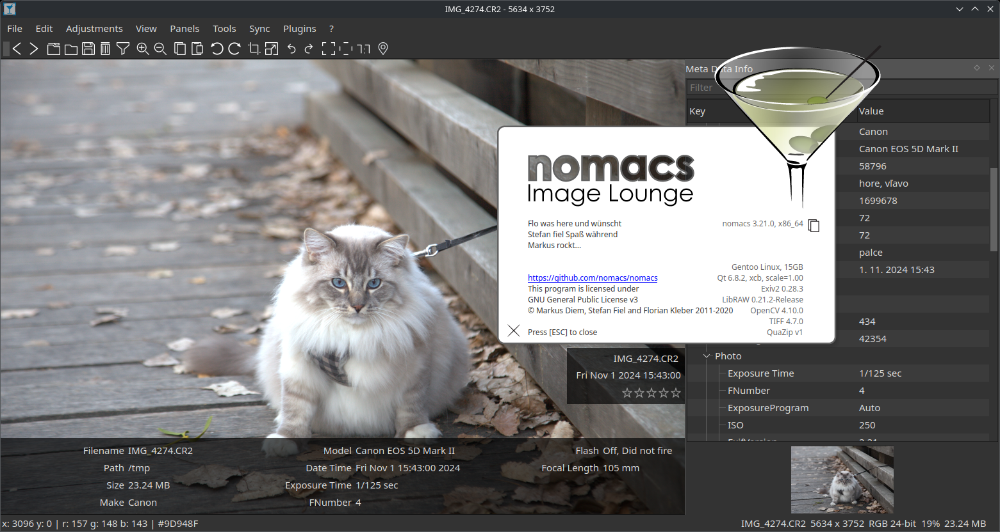
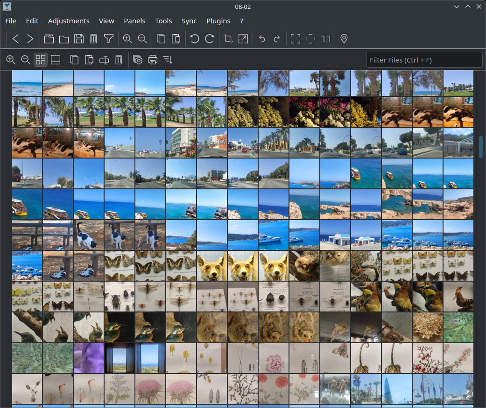

<table><tr>
<td></td>
<td></td>
</tr></table>

# nomacs - Image Lounge 🍸

nomacs is a free, open source image viewer, which supports multiple platforms. You can use it for viewing all common image formats including RAW and psd images. nomacs is licensed under the GNU General Public License v3 and available for Windows, Linux, FreeBSD, Mac, Haiku, and OS/2.

[](https://ci.appveyor.com/project/novomesk/nomacs)
[](https://github.com/nomacs/nomacs/releases/latest)
[](https://crowdin.com/project/nomacs-neo)


## Downloads

- [Latest stable release](https://github.com/nomacs/nomacs/releases/latest)
- [Latest beta release](https://github.com/nomacs/nomacs/releases)
- [Continuous builds (Windows)](https://ci.appveyor.com/project/novomesk/nomacs/history)
- [Continuous builds (Linux,macOS)](https://github.com/nomacs/nomacs/actions)


## Get the Source

```console
git clone https://github.com/nomacs/nomacs.git
cd nomacs

# nomacs uses submodules for third party libraries
git submodule init
git submodule update
```

## Build nomacs (Windows MSVC)

The [MSVC Readme](scripts/windows-msvc/readme.txt) details how to compile all 3rd-party dependencies and nomacs.

The [AppVeyor configuration](appveyor.yml) details the build steps we use for release builds.

## Build nomacs (Linux/Unix)

Before you build nomacs, please note the following:

- Nomacs requires Qt6, Qt5 is no longer supported.
- [kimageformats-plugins]([https://github.com/KDE/kimageformats](https://invent.kde.org/frameworks/kimageformats)) is an optional dependency that provides additional formats such as AVIF, HEIC/HEIF, and JPEG XL/JXL. It must be the Qt6 version of the plugins (some distros have both Qt5 and Qt6)
- Zip file support requires Quazip for Qt6 and `ENABLE_QUAZIP=ON`. Quazip has varied support in distributions. If the system package is missing, outdated, or compiled for Qt5, you must compile it separately for Qt6. In some cases, you may also need to remove the any other Quazip development package from your system (such as `llibquazip*-dev` for Ubuntu)
- The [Linux workflow file](.github/workflows/linux.yml) may provide additional hints if you get stuck.

### Get the required packages

The package lists and cmake configuration listed below enable all features in nomacs, which we recommend. However, if you do not want a particular feature you can omit certain packages.

#### Build options and dependencies

Nomacs has several optional features which require 3rd-party software packages. To ensure a feature is included/excluded set the cmake option for that feature. By default, all features are enabled if the dependencies are found when running cmake**.

The following Qt components are necessary: Core, Concurrent, Network, PrintSupport, SVG, Widgets, Core5Compat.

There are other optional features that can be enabled during build:

| Option             | Depends on     | Requires        | Description
| ------------------ | -------------- | --------------- | -
| `ENABLE_RAW`       | LibRAW         | `ENABLE_OPENCV` | Enables reading RAW images
| `ENABLE_TIFF`      | LibTiff        | `ENABLE_OPENCV` | Enable reading multi-page TIFF
| `ENABLE_QUAZIP`    | Quazip**       |                 | Enable reading from zip files
| `ENABLE_OPENCV`    | OpenCV         |                 | RAW, TIFF, Adjustments, High-quality thumbnails, DRIF files, histogram, mosaic
| `ENABLE_PLUGINS`   | nomacs/plugins | `ENABLE_OPENCV` | Paint on image, Composite, Affine Transform, Fake Miniatures, Page Extraction
| `ENABLE_TESTING`   | GoogleTest     |                 | Enables targets for unit and integration testing

(**) Quazip is not enabled by default as of nomacs 3.19.1

#### Runtime dependencies

Additional packages will be used by nomacs if they are available at runtime, provided they use Qt6.

- QImageFormats: Enables reading ICNS, MNG, TGA, TIFF, WBMP, WEBP
- KImageFormats: Enables reading AVIF, HEIF/HEIC, JXL, EXR, EPS and [more](https://github.com/KDE/kimageformats)

#### Ubuntu 24.04 - 26.04

```console
sudo apt install qt6-base-dev qt6-tools-dev qt6-svg-dev qt6-image-formats-plugins libexiv2-dev libraw-dev libopencv-dev libtiff-dev libtiff-dev libquazip1-qt6-dev build-essential git cmake lcov libgtest-dev
```

#### Ubuntu 22.04

```console
sudo apt install qt6-base-dev qt6-tools-dev qt6-tools-dev-tools libqt6svg6-dev libqt6core5compat6-dev qt6-l10n-tools qt6-image-formats-plugins libexiv2-dev libraw-dev libopencv-dev libtiff-dev libtiff-dev build-essential git cmake lcov libgtest-dev libgl-dev
```

#### Arch

```console
sudo pacman -S qt6-base qt6-imageformats qt6-svg qt6-tools quazip-qt6 exiv2 libraw libtiff opencv kimageformats git cmake gtest base-devel
```

#### Redhat/Fedora/CentOS (tested on Rocky 9.5)

```console
sudo dnf install qt6-qtbase-devel qt6-qtimageformats qt6-qtsvg-devel qt6-qttools-devel qt6-qt5compat-devel LibRaw-devel opencv-devel exiv2-devel libtiff-devel git cmake lcov gtest-devel gcc-c++
```

#### FreeBSD (14.2 release)

```console
sudo pkg install qt6-base qt6-imageformats qt6-svg qt6-5compat qt6-tools quazip-qt6 tiff exiv2 kf6-kimageformats libraw opencv git cmake googletest gcc
```

#### Haiku (r1 beta 5)

```console
pkgman install qt6_base_devel qt6_tools_devel qt6_svg_devel qt6_5compat_devel quazip1_qt6_devel tiff_devel libraw_devel opencv_devel gtest_devel exiv2_devel kimageformats6 qt6_imageformats cake git gcc make pkgconfig lcms_devel
```

### Configure nomacs

Nomacs is configured with cmake. These cmake options are often needed:

- ENABLE_QUAZIP=[ON|OFF] - Default OFF
- CMAKE_BUILD_TYPE=[Debug|Release|RelWithDebInfo] - For normal usage, choose `RelWithDebInfo`. For development, `Debug` builds have more logging and compile much faster.

```console
cd nomacs
mkdir build
cd build
cmake ../ImageLounge
```

### Compile nomacs

```console
make [-j 8]
```

You will now have a binary (~/nomacs/build/nomacs), which you can use directly, however you may need to set `LD_LIBRARY_PATH` for this to work. You can check the log output to see that nomacs is loading configuration files from the expected locations.

```console
# running nomacs from ~/nomacs/build/
LD_LIBRARY_PATH=.:$LD_LIBRARY_PATH ./nomacs
```

## Build and run tests

Nomacs uses [GoogleTest](https://github.com/google/googletest), which is included in the package lists above. A `check` target will be created if GoogleTest is present. To build and run tests:

```bash
make check
```

Unit and integration tests can also be built and run separately:

```bash
make check-unit
make check-integration

# Alternatively, invoke with ctest
ctest -L unit
ctest -L integration
```

### Install nomacs

By default nomacs is installed to /usr/local/ unless you set `CMAKE_INSTALL_PREFIX`

```console
sudo make install
# ldconfig is required on most linux distros
# Some systems you also require changes to 
# `/etc/ld.so.conf` to add `/usr/local/lib` 
sudo ldconfig
```

### For Package Maintainers

- Recommended optional dependency: qt-imageformats-plugins provides WEBP and many more formats
- Recommended optional dependency: quazip provides support for reading images from zip files (with `ENABLE_QUAZIP=ON`).
- Recommended optional dependency: kimageformats provides AVIF, HEIF/HEIC, JXL and many more formats.
- Recommended build dependency: gtest so you may run `make check` to validate the build
- Ensure `ENABLE_TRANSLATIONS` is `ON` (default: `ON`)
- Nomacs only requires the opencv-core and opencv-imgproc components at runtime, not the full opencv suite. This will save substantial space when installing nomacs.

## Build nomacs (MacOS)

Install [Homebrew](http://brew.sh/) for easier installation of dependencies.

Install required dependencies:

```console
brew install qt6 exiv2 opencv libraw quazip cmake pkg-config
```

Create a separate directory for build commands in the nomacs source tree:

```console
cd nomacs
mkdir build
cd build
```

Build the required KDSingleApplication dependency and install into `deps`:

```console
git clone --depth 1 --branch v1.2.1 https://github.com/KDAB/KDSingleApplication.git kdsa
cmake -S kdsa -B kdsa/build -DCMAKE_BUILD_TYPE=Release \
  -DCMAKE_PREFIX_PATH="$(brew --prefix qt6)" -DCMAKE_INSTALL_PREFIX="$PWD/deps"
cmake --build kdsa/build --parallel
cmake --install kdsa/build
```

Configure nomacs with zip support and cmake prefix for `deps` and Qt6:

```console
cmake -D ENABLE_QUAZIP=ON -DCMAKE_PREFIX_PATH="$PWD/deps;$(brew --prefix qt6)" ../ImageLounge
```

Compile nomacs:

```console
cmake --build . --parallel
```

You will now have a binary (`nomacs.app`), which you can test (or use directly):

```console
# simulate opening from Finder
open nomacs.app

# to see logging
./nomacs.app/Contents/MacOS/nomacs
```

Homebrew seems to be missing kimageformats so we haves this option until that happens:

```console
make kimageformats
```

Nomacs registers supported file types via the Info.plist file in the app bundle. This is essential for open-with, drag-and-drop, etc features of the Finder. Supported types vary depending on what options to cmake, Qt and OS version, homebrew configuration, and even nomacs user-specified custom file types (via `Tools/Add Image Format`).

Note that nomacs does not automatically make itself the default application for any supported types at this time, you will need to you use the open-with function in "Get Info" etc.

To ensure it is correct for the current build, run

```console
make filetypes
make
```

When you are satisfied and want to install it to `/Applications`, use:

```console
sudo make install
```

If you want a self-contained bundle (`nomacs.app`) and dmg file (`nomacs.dmg`) that can't be broken by homebrew updates, use:

```console
make bundle
```

If macdeployqt complains about `ERROR: Cannot resolve rpath "@rpath/QtGui.framework/Versions/A/QtGui"` [here](https://github.com/orgs/Homebrew/discussions/2823#discussioncomment-2010340) is the solution:

```console
cd /usr/local/lib/QtGui.framework/Versions/A
install_name_tool -id '@rpath/QtGui.framework/Versions/A/QtGui' QtGui
otool -L QtGui | head -2
QtGui:
        @rpath/QtGui.framework/Versions/A/QtGui (compatibility version 6.0.0, current version 6.7.0)
```

## Build nomacs (Windows Cross-Compile)

Compiles nomacs for Windows using M Cross Environment (MXE) from a Linux/Unix host.

MXE environment is usually compiled from source, however you may be able to skip this if MXE has packages for your platform:

```bash
git clone <mxe url>
cd mxe

# qt6 (quazip-qt6 is unavailable)
make MXE_TARGETS='x86_64-w64-mingw32.shared' qt6-qtbase qt6-qtimageformats qt6-qttools qt6-qt5compat opencv tiff exiv2 libraw
```

Setup build environment:

```bash
export MXE_DIR=~/mxe
export MXE_TARGET=x86_64-w64-mingw32.shared
export PATH="${MXE_DIR}/usr/bin:$PATH"

alias pkg-config=${MXE_TARGET}-pkg-config
alias qmake=${MXE_TARGET}-qmake
alias cmake=${MXE_TARGET}-cmake
```

Run cmake out-of-tree:

```bash
mkdir build-nomacs
cd build-nomacs

cmake -D ENABLE_TRANSLATIONS=ON -D ENABLE_HEIF=ON -D ENABLE_AVIF=ON  \
-DENABLE_JXL=ON -D USE_SYSTEM_QUAZIP=OFF <nomacs-path>/ImageLounge
```

Compile nomacs:

```bash
make -j8
make collect
```

Run on WINE:

```bash
wine nomacs-mingw/nomacs.exe
```

Run on Windows:

```console
cd C:\
xcopy /DEY <shared-folder>\build-nomacs\nomacs-mingw nomacs
cd nomacs
nomacs.exe
```

## Build nomacs (Windows with MSYS2)

```bash
export target=mingw-w64-x86_64

pacman -S $target-qt6-base $target-qt6-svg $target-qt6-tools \
          $target-libraw $target-libtiff $target-exiv2 $target-opencv $target-cmake $target-gcc

export PATH=/ming64:$PATH

cd <build-dir>

cmake -D ENABLE_TRANSLATIONS=ON -D USE_SYSTEM_QUAZIP=ON <nomacs-dir>/ImageLounge

cmake --build . --parallel 8
```

## Enable Debug output

To enable Qt debug messages set

```bash
cmake -D CMAKE_BUILD_TYPE=Debug ...
```

at the Makefiles generation phase.

## Links

- [nomacs.org](https://nomacs.org)
- [GitHub](https://github.com/nomacs)
- [Matrix chat room](https://matrix.to/#/#nomacs:matrix.org)

[](https://nomacs.org)
